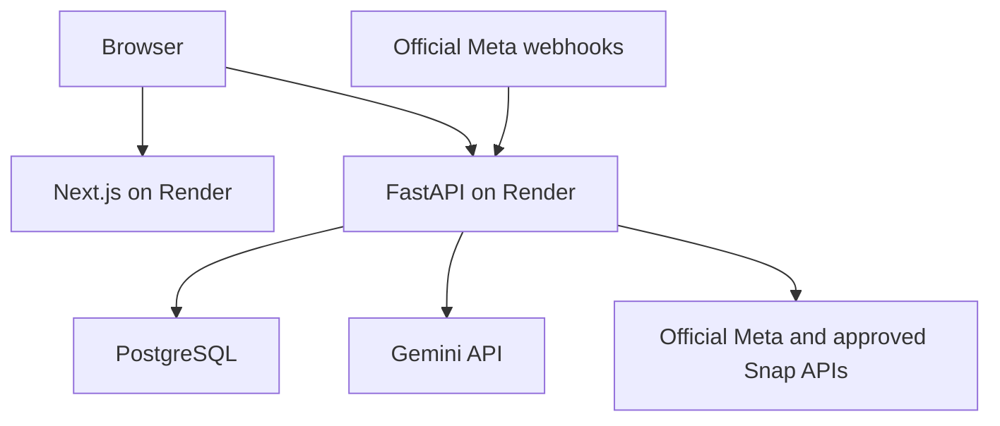

# RoastAI architecture and operating boundaries

The frontend serves UI assets; the browser calls the configured HTTPS API directly through restricted CORS. Gemini/Meta/Snap secrets are backend environment variables. Google client ID is intentionally public; its tokens are verified server-side. No unofficial automation exists.

Database revisions 0001–0004 are additive. Existing messages, activity, settings and sessions remain. Legacy records belong to owner workspace 0. Friend accounts use server-derived user IDs from hashed session tokens; incoming owner IDs from clients are never accepted. Messages are scoped by owner, platform and conversation ID. New Studio conversations use random IDs; legacy `roast-me` remains readable.

Each Studio generation has a request ID scoped to the authenticated workspace and a fingerprint of its input/settings. PostgreSQL's unique constraint claims that request before AI work. Replays return the persisted result; mismatched input and concurrent requests are rejected. Incoming/outgoing messages, activity and successful request result commit in one transaction. Failed requests persist their sanitized failure. A lost in-flight request after process interruption remains `processing`; it is not automatically resent. Review such requests before deliberately generating again. There is no promise of exactly-once billing at the upstream AI provider.

One Gemini call normally returns both comeback and English meaning. Up to two attempts are permitted for transient 408/5xx, connect or timeout errors; SDK nested retries are disabled. Key/model/permission/quota errors and malformed/empty output are not blindly retried. Per-attempt timeout is 12 seconds, with a 30-second elapsed budget checked between attempts. Network phase timeouts can affect exact wall time. Token counters are taken from SDK usage metadata; missing counters remain unknown. Thinking tokens and failed/ambiguous attempts may be billed separately.

Provider health is a recent generation observation, separate from credential configuration and bot enabled state. Health observations expire after ten minutes; health polls make no AI calls. `/health` and `/` check database connectivity and the queue worker, not Google availability. A health observation reflects the latest completed observation, not guaranteed future availability.

Meta webhooks require HMAC-SHA256 signatures and match configured account IDs. Duplicate message IDs are rejected by a durable unique constraint. Worker leadership uses a PostgreSQL advisory lock. Crash-interrupted sends remain uncertain and are not automatically replayed. SOCIAL_DELIVERY_APPROVED defaults false and enforces dry-run even if a saved preference says otherwise. Tokens and raw upstream error strings are never logged.

Password accounts use salted, versioned scrypt (N=32768, r=8, p=1). Existing N=16384 hashes are verified and upgraded on successful login. Session bearer tokens are random, stored hashed, expire in 24 hours, and are revoked by logout. The current browser uses sessionStorage for refresh persistence. This is JavaScript-readable and depends on XSS prevention; an HttpOnly cookie/proxy migration is a future security improvement, not part of this release. Owner ADMIN_TOKEN is long-lived and must not be distributed to friends. Password recovery and email verification are not implemented; make this explicit before public commercial onboarding.

Rate limits are per-process IP/account buckets. Current deployment is one worker/one instance. They reset on restart; multi-instance operation needs shared durable rate limits. History retention and request-record retention need a buyer's policy before sustained public volume; no destructive cleanup runs automatically.
